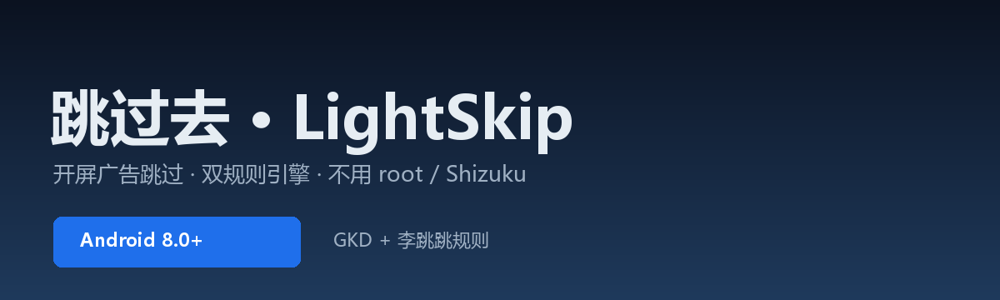

  
 
      
 <h1 align="center">跳过去 · LightSkip</h1> 
 开屏广告跳过工具 · GKD + 李跳跳双规则引擎 · 不用 root / Shizuku 
 
   

✨ 它是什么
「跳过去」是一个基于 Android 无障碍服务的广告跳过工具。

不修改目标 App、不破解会员、不拦截网络请求，只在广告出现时帮你点一下「跳过 / 关闭」。

🚀 核心功能
功能	说明
🧠 双规则引擎	GKD 选择器订阅 + 李跳跳 {id, action} + 通用兜底
🔄 订阅自动更新	内置 9 个 GKD 订阅，每 6 小时检查，也可手动更新
🎛 逐应用控制	每个 App 单独开关：规则库 / 李跳跳 / 通用 / 开屏 / 弹窗
🛡 防误触保护	支付、通话、功能面板、长按菜单、转发、下载，整页不动作
🧩 规则组合并	跨订阅重复规则只显示一条，并标出来源
📌 最近跳过置顶	刚跳过的 App 自动排到应用页最上面
🌐 中英文界面	设置 → 保活 → English
⬆️ 应用内更新	检查、下载、安装，走 jsDelivr 加速
📥 下载
渠道	链接
jsDelivr（推荐）	LightSkip-3.10.5.apk
GitHub Raw	LightSkip-3.10.5.apk
SHA-256：

代码块

3059A5993B2076C2CC4BE35BC0A269234058FB4B8E5660DA39571B9C4A80F510
Android 8.0+，首次安装需允许「安装未知应用」。

🖼 界面预览

    

预览图请把截图放到仓库 docs/ 目录，文件名对应 shot-home.png、shot-apps.png、shot-detail.png。

📦 安装
下载并安装 APK
打开 App，按首页提示开启无障碍服务
建议加入电池白名单（设置 → 保活）
打开任意带开屏广告的 App 测试
⚠️ 已知限制
保活模式会显示一条前台服务通知（Android 8+ 强制）
强行停止 App 后无障碍会变「不工作」，需要重新打开一次
分屏里的第二个应用只走「自定义 + 通用」引擎
英文界面还差少数技术文案
swipe / setText 类 GKD 动作暂不支持
❓ FAQ

 
<b>为什么不用 root / Shizuku？</b>

无障碍足够完成点击，root 风险更高，Shizuku 需要额外维护。

 
 
<b>会不会误点？</b>

默认有 650ms 冷却、同一按钮 2 秒去重、单次会话上限 12 次，外加支付/通话/菜单/转发/下载整页保护。

 
 
<b>更新下载卡住？</b>

3.10.3 起下载自动改走 jsDelivr；旧版本请手动装一次新包。

📝 更新日志
3.10.5
系统应用名统一解析，不再显示包名
修复微信长按菜单被拦截（补上长按/触摸事件订阅）
关掉「弹窗/关闭」后，非开屏页面完全不处理
英文第二批 + 系统应用名英文化
更新下载改走 jsDelivr
3.10.0
规则组跨订阅合并
应用列表按最近跳过置顶
英文界面第一批
🙏 规则来源
GKD：选择器引擎与订阅生态
李跳跳规则：社区整理
订阅作者：aoguai、kunjinkao、adpro、aisouler、ganlinte、lisrain 等
规则版权归各作者，本项目仅做规则执行。

📄 License
GPL-3.0
